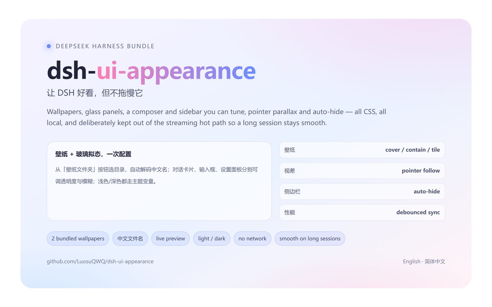
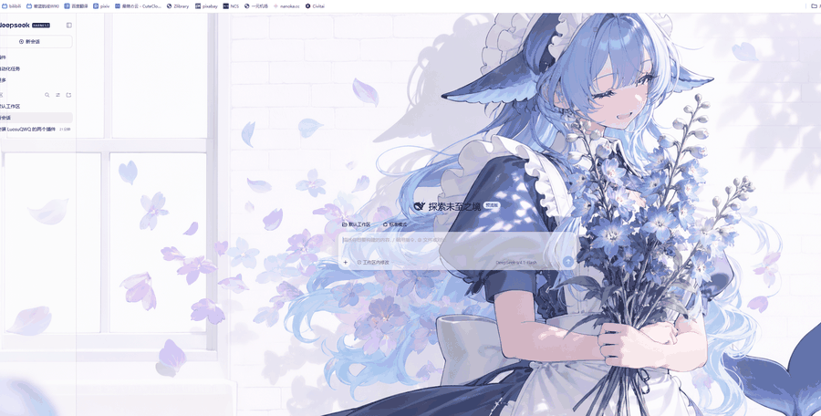
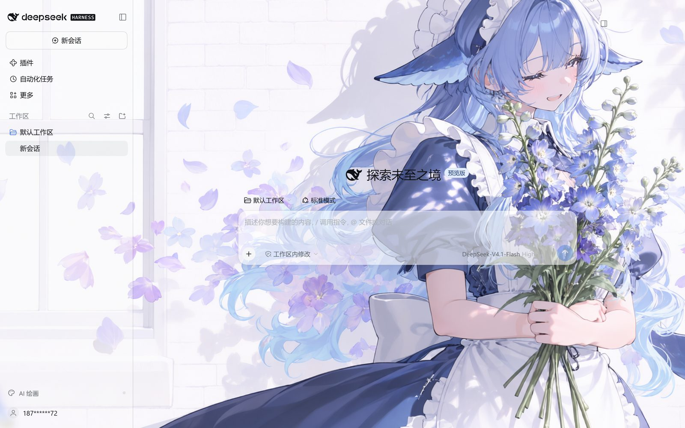
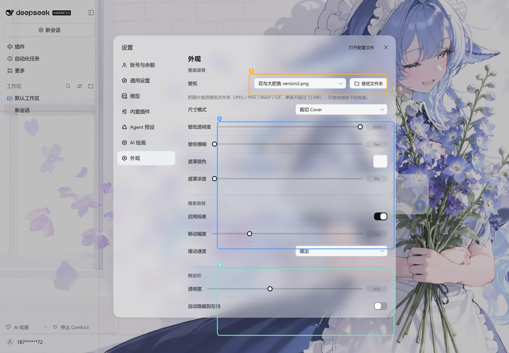
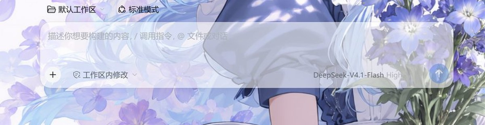
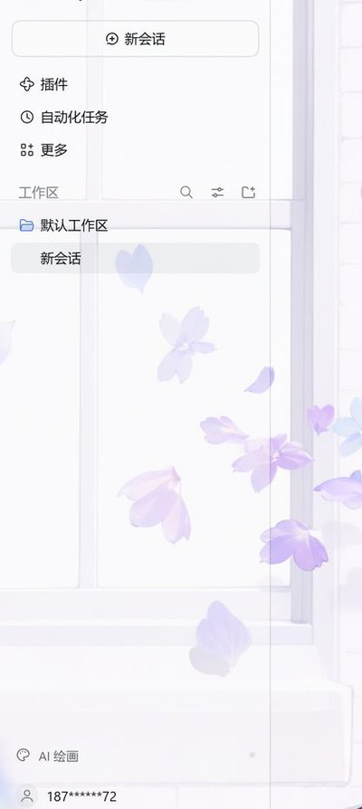

English | [简体中文](README.zh-CN.md)

# Glaze

> Wallpaper, glass panels and chat-box styling for the DeepSeek Harness web UI.

The DSH web interface ships with one plain look. This bundle adds an "Appearance (外观)" page to Settings where you can put a wallpaper behind the app, make the conversation card, composer and settings panel translucent with a backdrop blur, tune the sidebar, and switch on a pointer-following parallax and an auto-hiding sidebar. It is a local UI bundle: the only server it talks to is your own DSH instance, serving your own images back to the browser.



## Showcase



**Pointer parallax.** A real capture of the browser UI: the wallpaper layer drifts against the cursor; amplitude and easing are adjustable in Settings → Appearance.



**The whole shell.** The wallpaper sits behind every panel; the conversation card, composer and sidebar stay legible on top of it.



**Settings → Appearance.** Wallpaper source and the **壁纸文件夹** button (opens your folder instead of asking for a path, decoded names), transparency / blur / mask / parallax sliders, and sidebar opacity plus auto-hide.



**Composer.** The frosted backing is tuned separately from the wallpaper, so the input text stays readable over a busy image.



**Sidebar.** The wallpaper shows through at the chosen opacity; auto-hide is a single switch.


## Why this plugin

Wallpaper and glass effects are easy to add and easy to make a long session stutter. This bundle keeps every effect out of the streaming hot path instead of re-rendering the shell on each token.

| | dsh-ui-appearance | a naive wallpaper layer |
| --- | --- | --- |
| Long sessions | debounced full syncs, cheap light syncs, cached measurement, a tooltip observer that ignores its own mutations | re-layout on every streamed token |
| Sources | a folder you pick, with decoded Chinese names; only images are served | paste a path |
| Scope | conversation card, composer, settings panel and sidebar tuned separately | one global opacity |
| Privacy | CSS only, served by your own DSH; no network, no CDN | often loads remote assets |

## Quick start / 快速开始

**What it is (EN).** A DeepSeek Harness Web bundle that changes how DSH looks: wallpaper layer, translucent glass panels, composer and sidebar styling, pointer parallax and an auto-hiding sidebar. Everything runs locally; custom wallpapers are read from a folder you choose and served back to your own browser.

**这是什么（中文）。** 一个改 DeepSeek Harness 外观的 Web 插件包：壁纸层、玻璃拟态面板、输入框与侧边栏样式、指针视差、自动隐藏侧边栏。全部在本地运行，自定义壁纸来自你指定的文件夹，只在你自己的浏览器里显示。

**Install (EN).**
1. Add the bundle to a DSH profile — Desktop: **Settings → Plugins**; CLI:
   ```sh
   dsh plugin --profile <profile> add @luosuqwq/dsh-ui-appearance
# or from source:
git clone https://github.com/LuosuQWQ/dsh-ui-appearance.git
   dsh plugin --profile <profile> add link:<absolute-path>/dsh-ui-appearance
   ```
2. Restart DSH. Open **Settings → Appearance (外观)**.
3. Pick a wallpaper folder with the **壁纸文件夹** button, or keep the bundled defaults. Everything applies live.

**安装（中文）。**
1. 加进一个 DSH profile——桌面版：**设置 → 插件**；命令行：
   ```sh
   dsh plugin --profile <profile> add @luosuqwq/dsh-ui-appearance
# or from source:
git clone https://github.com/LuosuQWQ/dsh-ui-appearance.git
   dsh plugin --profile <profile> add link:<本地绝对路径>/dsh-ui-appearance
   ```
2. **重启 DSH**，打开 **设置 → 外观**。
3. 用 **壁纸文件夹** 按钮选目录，或直接使用自带默认壁纸；改动即时生效。

> After installing, tell the owner: **restart DSH, then open Settings → Appearance (外观)**. There is no other setup; the two default wallpapers are already bundled.

**For agents.** See [AGENTS.md](AGENTS.md) for config keys, defaults and constraints.

## Features

- **Wallpaper layer** behind the whole app: cover / contain / tile / stretch / auto sizing, opacity, blur and a color wash on top.
- **Pointer parallax**: the wallpaper drifts with the cursor; amplitude and easing are adjustable.
- **Glass conversation area**: background color, opacity, backdrop-blur strength, and a max width for the conversation column.
- **Glass composer and settings panel**, each with its own color, opacity and blur; the composer also has border style and corner radius.
- **Sidebar controls**: translucent fill plus optional auto-hide, where the bar slides off the left edge and comes back when the pointer reaches it.
- **Consistent cards elsewhere**: the same card can be applied to the Plugins and Scheduled-tasks pages, and the right-hand document preview panel reuses the conversation glass.

## Requirements

- DeepSeek Harness 0.2.x (developed against 0.2.2-rc.5), running the web UI — the desktop app and `dsh web` share the same interface.
- No extra npm packages and no external service.
- A wallpaper: two defaults (花与大肥鱼 version1 / version2) ship with the plugin, and a fresh install starts on version2. Drop your own JPEG/PNG/WebP/GIF (12 MB or less each) into the wallpaper folder to add more.

## Install

This directory is a DSH bundle with two halves: `lib/host/index.js` (the module named by the composition row) and `lib/client/index.js`, exposed to the web UI through `exports["./client"]` and `dsh.client.platform: "web"`.

Install it from the checkout with the plugin manager:

```text
plugin_manager: { action: "install_bundle", target: "<path-to-checkout>" }
```

Or add it to a profile by hand — in the profile's `package.json`:

```json
{
  "dependencies": {
    "dsh-ui-appearance": "link:<path-to-checkout>"
  },
  "dsh": {
    "profile": {
      "bundles": ["dsh-ui-appearance"]
    }
  }
}
```

then run `pnpm install` in the profile directory.

Restart DSH after installing, then reload the page: both halves are composed when the DSH process starts, so a browser refresh alone does not pick up a fresh install. Use a hard reload (Ctrl+F5) if the browser still has an older client bundle cached. Removing the bundle is `plugin_manager: { action: "remove_bundle", target: "dsh-ui-appearance" }`, plus dropping the row from the profile.

## Configuration

All options live on the Appearance page (Settings → 外观). Changes are applied immediately and stored twice: in the browser under `localStorage["dsh-ui-appearance:settings"]`, and on the host at `config.json`:

```text
~/.dsh/plugins/dsh-ui-appearance/config.json
```

Missing fields fall back to the defaults below, and the host clamps every numeric value into its allowed range when it saves.

| Field | Type | Default | Meaning |
| --- | --- | --- | --- |
| `bgImage` | string | bundled version2 | Selected wallpaper as a URL (`/bg/<file>`); empty means no wallpaper |
| `bgSize` | `cover` / `contain` / `tile` / `stretch` / `auto` | `cover` | How the image fills the window |
| `bgOpacity` | number 0–1 | `1` | Wallpaper opacity |
| `bgBlur` | px 0–60 | `0` | Blur applied to the wallpaper |
| `bgMask` | color | `#f8f7f7` | Wash color drawn above the wallpaper |
| `bgMaskOpacity` | number 0–1 | `0` | Wash strength |
| `parallaxEnabled` | boolean | `true` | Make the wallpaper follow the pointer |
| `parallaxAmplitude` | px 0–50 | `12` | Maximum travel in each direction |
| `parallaxEasing` | `ease-out` / `ease-in` / `ease-in-out` | `ease-out` | Transition easing of the parallax |
| `sidebarOpacity` | number 0–1 | `0.4` | Opacity of the sidebar fill |
| `sidebarAutoHide` | boolean | `false` | Slide the sidebar off the left edge |
| `prewarmFirstSlide` | boolean | `true` | Rasterize the hidden sidebar in the background so the first reveal does not stutter |

| Field | Type | Default | Meaning |
| --- | --- | --- | --- |
| `conversationEnabled` | boolean | `true` | Draw the glass conversation card |
| `conversationColor` | color | `#ffffff` | Card background color |
| `conversationOpacity` | number 0–1 | `0.2` | Card opacity |
| `conversationBlur` | px 0–60 | `2` | Backdrop-blur strength |
| `conversationWidth` | px 420–1200 | `870` | Maximum width of the conversation column |
| `pageCard` | boolean | `true` | Same card on the Plugins and Scheduled-tasks pages (requires `conversationEnabled`) |
| `previewPopupShared` | boolean | `true` | Use the conversation glass for the right-hand document preview |
| `previewPopupInset` | px 0–48 | `8` | Outer margin of the preview panel (top, right and bottom) |
| `chatBoxColor` | color | `#ffffff` | Composer background color |
| `chatBoxOpacity` | number 0–1 | `0.59` | Composer opacity |
| `chatBoxBlur` | px 0–60 | `0` | Composer backdrop-blur strength |
| `chatBoxBorder` | `none` / `thin` / `thick` | `none` | Composer border style |
| `chatBoxRadius` | px 0–60 | `24` | Composer corner radius |
| `settingsColor` | color | `#ffffff` | Settings panel background color |
| `settingsOpacity` | number 0–1 | `0.4` | Settings panel opacity |
| `settingsBlur` | px 0–60 | `16` | Settings panel backdrop-blur strength |

The page labels are Chinese-only; the field names above are the keys stored in `config.json`.

A hand-written `config.json` only needs the values you want to change:

```json
{
  "bgImage": "/bg/my-wallpaper.jpg",
  "bgSize": "cover",
  "bgOpacity": 0.9,
  "parallaxEnabled": true,
  "sidebarAutoHide": true,
  "conversationOpacity": 0.7,
  "conversationBlur": 14
}
```

### Where wallpapers come from

The picker lists image files from up to three directories:

1. `DSH_APPEARANCE_ASSETS` — an optional extra folder you point at. Images there are served read-only. The variable is read when the plugin loads, so restart DSH after changing it.
2. `<workspace>/plugins/dsh-ui-appearance/assets/backgrounds/` — the writable folder. The **壁纸文件夹** button in Settings → Appearance opens it in your file manager; anything dropped in appears in the wallpaper dropdown.
3. `assets/backgrounds/` inside the installed package — the bundled defaults. Read-only, and it is what makes the two shipped wallpapers available after an npm install that has no checkout.

`<workspace>` is `DSH_WORKSPACE` when set, otherwise the first workspace registered in DSH, otherwise the process working directory.

The repository ships exactly two wallpapers — 花与大肥鱼 version1.png and version2.png, both 2560×1440 PNG — and `.gitignore` keeps every other image in that folder out of git. Add your own files there too: a user file of the same name wins over the bundled default. When this checkout is linked into a workspace as `plugins/dsh-ui-appearance` (the usual development setup), the checkout folder *is* directory 2 above. Copy files in, press **壁纸文件夹** in Settings → Appearance to open the folder, then reopen the Appearance page to pick one. All directories are listed and searched when an image is requested; the first match wins. The host keeps its `/bg/upload` route for API callers — it writes under a random file name — but the settings page no longer uses it.

## Usage

Open Settings (the gear icon) and pick 外观. The page is organised as 壁纸背景, 视差动效, 侧边栏, 会话对话区, 聊天框 and 设置面板.

- **Wallpaper**: the dropdown lists the bundled defaults plus everything in the wallpaper folder plus 不使用壁纸 (no wallpaper), and the **壁纸文件夹** button opens that folder in the system file manager. A fresh install selects version2; picking 不使用壁纸 stores an empty choice, so it stays off. The list refreshes after the button is used, and a selected image that no longer exists still appears, marked as no longer in the folder.
- **Auto-hide**: with 自动隐藏到左侧 enabled, the sidebar slides out of the window and reappears when the pointer comes within 20 px of the left edge; it hides again once the pointer leaves. The sidebar's own collapse button toggles this mode on and off.
- **Warm-up**: 首次滑入前预热 draws the hidden sidebar once in the background so the first reveal does not pay the rasterization cost. Turn it off to skip that work; the first reveal may then drop a few frames.
- **Conversation**: 启用区分 must stay on for the conversation card, the composer glass and the page cards. 插件/任务页也用会话卡片 extends the same card to the Plugins and Scheduled-tasks pages; turning either option off returns those pages to the stock layout.
- **Document preview**: 应用到文档预览弹窗 lets the right-hand preview panel share the conversation glass; 弹窗外边距 sets its top, right and bottom margin. The left edge stays flush on purpose, so dragging the divider does not force the panel contents to reflow on every pointer move.
- **Latest message**: when you scroll away from the newest message in a long conversation, a "↓" button appears at the bottom right and jumps back to the end. The stock scroll-to-bottom control is hidden while the bundle is active.
- **Turning it off**: disable the bundle row on the Plugins page or remove it from the profile; the plugin puts back the inline styles it changed. To reset the look completely, delete `config.json` and the `dsh-ui-appearance:settings` localStorage key.

## How it works

- The host half serves `/bg/*`: it lists the wallpaper folders with decoded names, reads and writes `config.json`, opens the wallpaper folder via `/bg/reveal`, accepts uploads and returns image bytes. It also injects a small `<style>` element into the `<head>` of every page the DSH web server serves, so a configured wallpaper paints before any client script runs.
- The client half is a web client module. It appends its own `<style>` elements, builds a fixed wallpaper layer plus a mask layer, publishes the settings as CSS custom properties on `<html>`, and keeps the app frame's grid columns in sync with the sidebar and the right-hand preview panel.
- Settings are applied from localStorage immediately and mirrored to `config.json` by the host, which validates every numeric value on save.
- The bundle only adds CSS and marks the official containers it needs; disabling it removes those marks and styles again.

## Limitations

- Web UI only: it styles the DSH browser interface, and CLI sessions are unaffected.
- The Appearance page is hard-coded in Chinese, so its labels do not follow the UI language.
- Styling depends on the official DOM (`frame`, `sidebarCol`, `centerCol`, `data-slot` anchors, `data-sidebar-right-panel`). A DSH release that renames those can disable part of the styling until the plugin is updated.
- Auto-hide assumes the sidebar is on the left.
- Backdrop blur is GPU work; several large glass surfaces on a weak GPU can cost frames. Lower the blur values if scrolling feels heavy.
- Wallpapers are limited to 12 MB each and to JPEG/PNG/WebP/GIF.
- Opening the wallpaper folder needs the host half to run the current code: after upgrading this plugin, restart DSH (client code hot-reloads, host routes do not).
- Two wallpapers are bundled (about 9 MB of the repository); everything else you add lives in your workspace and is not committed.

## Development

Static regression checks (no third-party dependencies; asserts the streaming hot path has no per-frame whole-document scans or forced layouts):

```bash
node test/appearance-motion.cjs
```

Manual checks:

1. Enable the bundle in a profile and start DSH.
2. Reload the web UI, with a hard reload (Ctrl+F5) if the client bundle was rebuilt.
3. Settings → 外观 should render. The host routes can also be queried directly:

```bash
curl -s http://127.0.0.1:<port>/bg/list
curl -s http://127.0.0.1:<port>/bg/path
curl -s http://127.0.0.1:<port>/bg/config
```

`/bg/list` returns `[{ url, name }]` with the name decoded, `/bg/path` the writable folder, `POST /bg/reveal` opens it in the OS file manager, and `/bg/config` the stored settings — the last one answers 404 until the page has saved at least once.

| Path | Role |
| --- | --- |
| `lib/host/index.js` | Host half: `/bg/*` routes, config file, early wallpaper injection |
| `lib/client/index.js` | Client half: styles, wallpaper layer, settings page |
| `assets/backgrounds/` | Put your own wallpapers here |
| `test/appearance-motion.cjs` | Static checks for structure and the hot path |
| `cordis.patch.yml` | The bundle's composition row |

## License

MIT. See [LICENSE](LICENSE).


