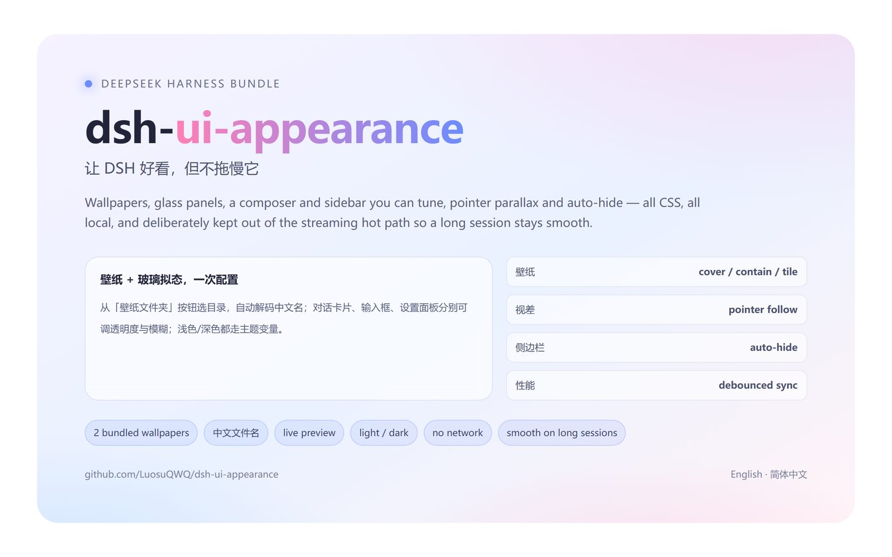
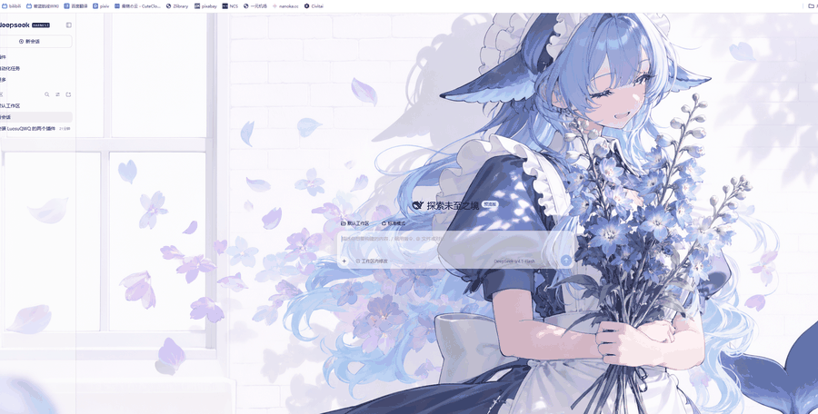
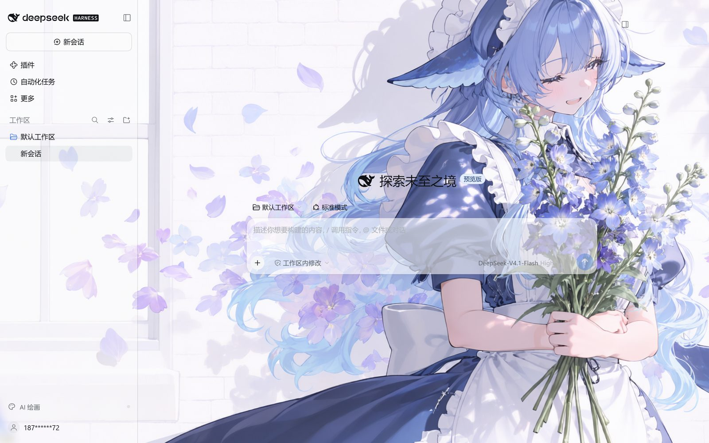
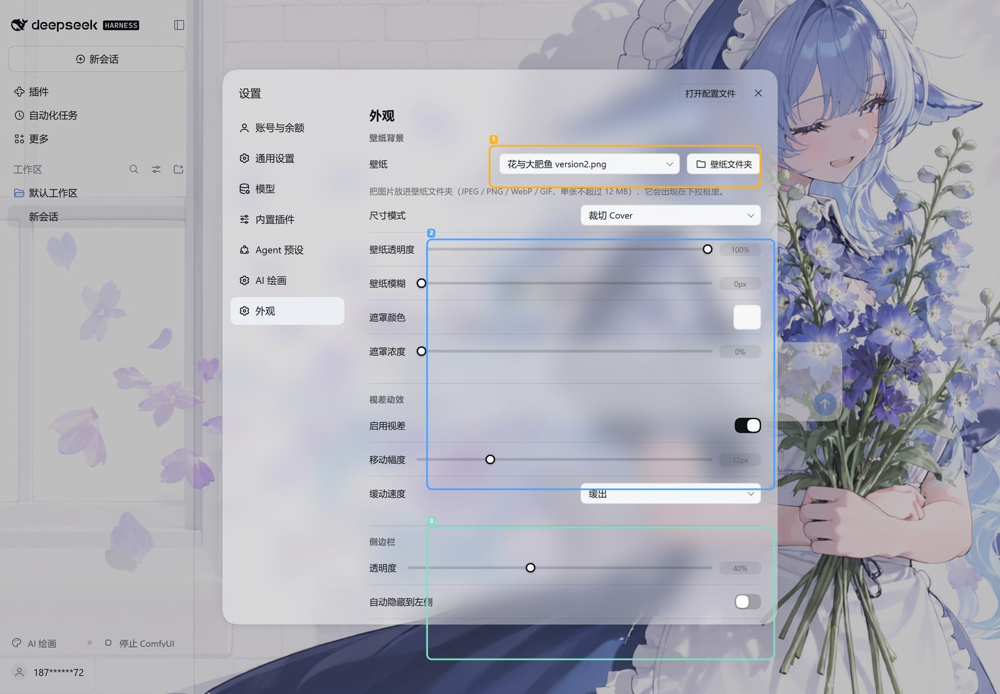
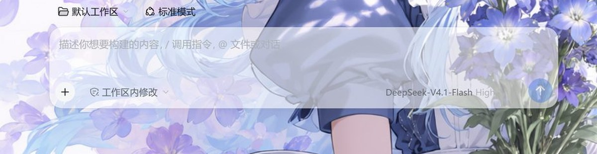
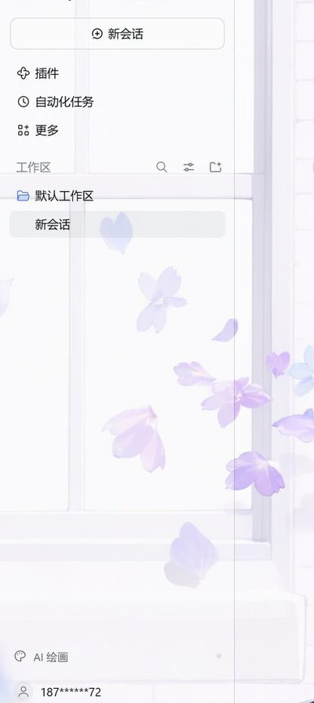
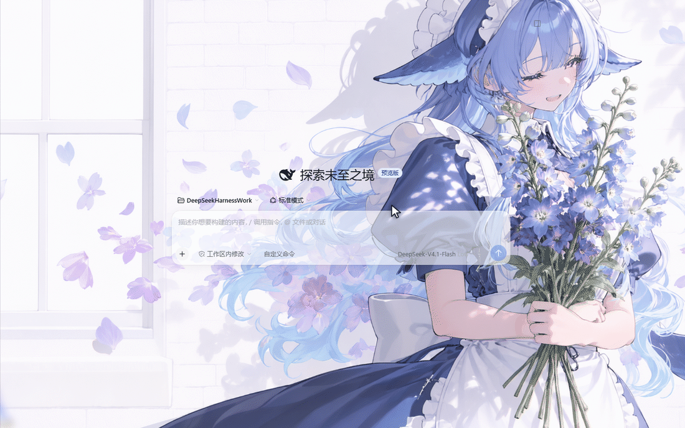
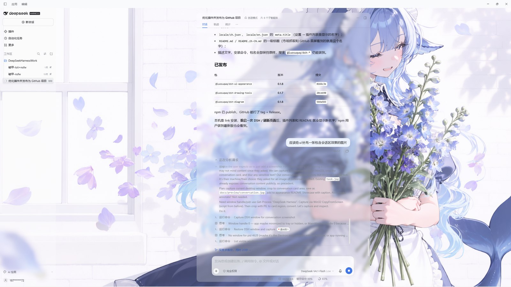

[English](README.md) | 简体中文

# 琉璃

> 给 DeepSeek Harness 的网页界面换上壁纸、毛玻璃面板与聊天框样式。

DSH 的网页界面默认只有一套朴素外观。这个 bundle 在设置里加了一页「外观」：可以把壁纸铺在背后，把会话卡片、输入框和设置面板做成半透明毛玻璃，调侧边栏的透明度，并打开跟随鼠标的视差和自动隐藏侧边栏。它是纯本地的界面插件——除了你自己的 DSH 服务在把图片发回浏览器之外，不连任何外部服务。



## 外观一览



**指针视差。** 浏览器界面里真实录制的：壁纸层随光标轻微反向漂移，幅度与缓动在「设置 → 外观」里调。



**整个界面。** 壁纸铺在所有面板后面；对话卡片、输入框、侧边栏仍保持清晰可读。



**设置 → 外观。** 壁纸来源与 **壁纸文件夹** 按钮（直接打开你的文件夹，中文名自动解码）、透明度/模糊/遮罩/视差滑杆、侧边栏透明度与自动隐藏。



**输入框。** 毛玻璃底色和壁纸分开调，复杂图片上输入的文字也不糊。



**侧边栏。** 壁纸按设定的透明度透出，自动隐藏一个开关。



**自动隐藏。** 浏览器界面里真实录制的：光标进入距左边缘 20 px 的范围，侧边栏用 220 ms 滑回屏幕；光标移开就沿着同一条曲线收回，主内容区不跟着重排。




**会话区。** 消息、工具卡片和输入框落在毛玻璃卡片上，壁纸在四周和玻璃后面仍然可见。

## 为什么用它

壁纸和玻璃效果容易加，也容易让长会话变卡。这个 bundle 的原则是：所有效果都离流式热路径远一点，而不是每来一个 token 就重排一次界面。

| | dsh-ui-appearance | 普通壁纸层 |
| --- | --- | --- |
| 长会话 | 防抖全量同步、轻量同步、缓存测量、忽略自身变更的 tooltip 观察器 | 每个流式 token 都重排 |
| 壁纸来源 | 选一个文件夹，中文名自动解码；只提供图片 | 手填路径 |
| 可调范围 | 对话卡、输入框、设置面板、侧边栏分开调 | 一个全局透明度 |
| 隐私 | 纯 CSS，只由你自己的 DSH 提供；无网络、无 CDN | 经常加载远程资源 |

## 快速开始 / Quick start

**这是什么。** 一个改 DeepSeek Harness 外观的 Web 插件包：壁纸层、玻璃拟态面板、输入框与侧边栏样式、指针视差、自动隐藏侧边栏。全部本地运行，自定义壁纸来自你指定的文件夹。

**What it is.** A DSH Web bundle that changes the look: wallpaper layer, glass panels, composer and sidebar styling, pointer parallax, auto-hiding sidebar.

**安装。**
1. 加进一个 DSH profile——桌面版：**设置 → 插件**；命令行：
   ```sh
   dsh plugin --profile <profile> add @luosuqwq/dsh-ui-appearance
# 或者从源码：
git clone https://github.com/LuosuQWQ/dsh-ui-appearance.git
   dsh plugin --profile <profile> add link:<本地绝对路径>/dsh-ui-appearance
   ```
2. **重启 DSH**，打开 **设置 → 外观**。
3. 用 **壁纸文件夹** 按钮选目录，或使用自带默认壁纸。

> 装好后请告诉主人：**重启 DSH，然后打开「设置 → 外观」**。不需要其他配置，自带两张默认壁纸。

**给 agent。** 配置键、默认值与约束见 [AGENTS.md](AGENTS.md)。

## 功能

- **整屏壁纸层**：裁切 / 居中 / 平铺 / 拉伸 / 适应五种尺寸模式，外加透明度、模糊和一层遮罩色。
- **指针视差**：壁纸随鼠标产生位移，幅度与缓动可调。
- **会话区毛玻璃**：底色、透明度、背景模糊强度，以及会话列的最大宽度。
- **输入框与设置面板毛玻璃**：各自独立的底色、透明度、模糊；输入框另有边框样式与圆角。
- **侧边栏控制**：半透明填充，可选的自动隐藏——侧边栏滑出左边缘，鼠标靠近时再滑回来。
- **卡片保持一致**：同一套卡片可以套到「插件」页和「自动化任务」页；右侧的文档预览面板复用会话区的玻璃参数。

## 运行要求

- DeepSeek Harness 0.2.x（基于 0.2.2-rc.5 开发验证），运行的是网页界面——桌面版和 `dsh web` 用的是同一个界面。
- 不需要额外的 npm 包，也不需要外部服务。
- 壁纸：随包附带两张默认壁纸（花与大肥鱼 version1 / version2），未配置过的新用户默认使用 version2。想加自己的图片，把 JPEG/PNG/WebP/GIF（单张不超过 12 MB）放进壁纸文件夹即可。

## 安装

这个目录是一个 DSH bundle，分两半：`lib/host/index.js`（组合行指向的模块）和 `lib/client/index.js`（通过 `exports["./client"]` 与 `dsh.client.platform: "web"` 提供给网页界面）。

用插件管理器从检出目录安装：

```text
plugin_manager: { action: "install_bundle", target: "<path-to-checkout>" }
```

也可以手工写进 profile 的 `package.json`：

```json
{
  "dependencies": {
    "dsh-ui-appearance": "link:<path-to-checkout>"
  },
  "dsh": {
    "profile": {
      "bundles": ["dsh-ui-appearance"]
    }
  }
}
```

然后在 profile 目录执行 `pnpm install`。

安装后要重启 DSH，再刷新页面：两半都在 DSH 进程启动时组合，只刷新浏览器不会加载新装的 bundle。如果浏览器还缓存着旧产物，用强制刷新（Ctrl+F5）。卸载用 `plugin_manager: { action: "remove_bundle", target: "dsh-ui-appearance" }`，同时把 profile 里那一行去掉。

## 配置

所有选项都在「设置 → 外观」页上。改动立即生效，并且存两份：浏览器里的 `localStorage["dsh-ui-appearance:settings"]`，以及宿主上的 `config.json`：

```text
~/.dsh/plugins/dsh-ui-appearance/config.json
```

缺失的字段回退到下面的默认值；宿主保存时会把每个数值夹到允许范围内。

| 字段 | 类型 | 默认值 | 说明 |
| --- | --- | --- | --- |
| `bgImage` | 字符串 | 随包 version2 | 选中的壁纸，形如 `/bg/<file>`；空表示不用壁纸 |
| `bgSize` | `cover` / `contain` / `tile` / `stretch` / `auto` | `cover` | 壁纸填充窗口的方式 |
| `bgOpacity` | 数值 0–1 | `1` | 壁纸透明度 |
| `bgBlur` | px 0–60 | `0` | 壁纸模糊 |
| `bgMask` | 颜色 | `#f8f7f7` | 压在壁纸上方的遮罩色 |
| `bgMaskOpacity` | 数值 0–1 | `0` | 遮罩浓度 |
| `parallaxEnabled` | 布尔 | `true` | 壁纸是否跟随鼠标 |
| `parallaxAmplitude` | px 0–50 | `12` | 每个方向的最大位移 |
| `parallaxEasing` | `ease-out` / `ease-in` / `ease-in-out` | `ease-out` | 视差过渡的缓动 |
| `sidebarOpacity` | 数值 0–1 | `0.4` | 侧边栏填充的透明度 |
| `sidebarAutoHide` | 布尔 | `false` | 把侧边栏滑出左边缘 |
| `prewarmFirstSlide` | 布尔 | `true` | 后台先光栅化一次隐藏的侧边栏，避免首次滑入掉帧 |

| 字段 | 类型 | 默认值 | 说明 |
| --- | --- | --- | --- |
| `conversationEnabled` | 布尔 | `true` | 是否绘制会话区的玻璃卡片 |
| `conversationColor` | 颜色 | `#ffffff` | 卡片底色 |
| `conversationOpacity` | 数值 0–1 | `0.2` | 卡片透明度 |
| `conversationBlur` | px 0–60 | `2` | 背景模糊强度 |
| `conversationWidth` | px 420–1200 | `870` | 会话列的最大宽度 |
| `pageCard` | 布尔 | `true` | 「插件」与「自动化任务」页也用同一张卡片（需要 `conversationEnabled`） |
| `previewPopupShared` | 布尔 | `true` | 右侧文档预览面板复用会话区的玻璃参数 |
| `previewPopupInset` | px 0–48 | `8` | 预览面板的外边距（上、右、下） |
| `chatBoxColor` | 颜色 | `#ffffff` | 输入框底色 |
| `chatBoxOpacity` | 数值 0–1 | `0.59` | 输入框透明度 |
| `chatBoxBlur` | px 0–60 | `0` | 输入框背景模糊强度 |
| `chatBoxBorder` | `none` / `thin` / `thick` | `none` | 输入框边框样式 |
| `chatBoxRadius` | px 0–60 | `24` | 输入框圆角 |
| `settingsColor` | 颜色 | `#ffffff` | 设置面板底色 |
| `settingsOpacity` | 数值 0–1 | `0.4` | 设置面板透明度 |
| `settingsBlur` | px 0–60 | `16` | 设置面板背景模糊强度 |

页面上的分组标题是「壁纸背景 / 视差动效 / 侧边栏 / 会话对话区 / 聊天框 / 设置面板」，上表的字段名就是 `config.json` 里的键名。

手写 `config.json` 时只写想改的值即可：

```json
{
  "bgImage": "/bg/my-wallpaper.jpg",
  "bgSize": "cover",
  "bgOpacity": 0.9,
  "parallaxEnabled": true,
  "sidebarAutoHide": true,
  "conversationOpacity": 0.7,
  "conversationBlur": 14
}
```

### 壁纸放在哪里

壁纸选择器会从最多三个目录读取图片：

1. `DSH_APPEARANCE_ASSETS` —— 可选，指向一个额外的图片目录，里面的图片只读提供。这个环境变量在插件加载时读取，改完要重启 DSH。
2. `<workspace>/plugins/dsh-ui-appearance/assets/backgrounds/` —— 可写目录。「设置 → 外观」里的 **壁纸文件夹** 按钮会用系统文件管理器打开它，放进去的图片会出现在壁纸下拉框里。
3. 安装包内的 `assets/backgrounds/` —— 随包附带的默认壁纸，只读。npm 安装（没有检出目录）时，默认壁纸就靠它提供。

`<workspace>` 取 `DSH_WORKSPACE`（设了的话），否则取 DSH 注册的第一个工作区，再否则取进程工作目录。

仓库只附带两张壁纸——花与大肥鱼 version1.png 和 version2.png（2560×1440 PNG，合计约 9 MB），`.gitignore` 会把该目录里的其它图片挡在仓库之外。你也可以把自己的图片放进去：同名文件优先于随包默认壁纸。当这个检出以 `plugins/dsh-ui-appearance` 的形式链接进工作区时（常见的开发方式），检出目录正是上面第 2 个目录。把文件拷进去，在「设置 → 外观」里点 **壁纸文件夹** 打开目录，回到「外观」页就能选。所有目录里的图片都会列进选择器、也都能被请求到，按顺序取第一个命中的文件。宿主仍保留 `/bg/upload` 接口给程序调用（写入时用随机文件名），设置页已不再使用它。

## 使用

打开「设置」（齿轮图标），选「外观」。页面分组为 壁纸背景、视差动效、侧边栏、会话对话区、聊天框、设置面板。

- **壁纸**：下拉框列出随包默认壁纸、壁纸文件夹里的图片以及「不使用壁纸」，右边的 **壁纸文件夹** 按钮用系统文件管理器打开那个目录。新安装默认选 version2；选过「不使用壁纸」会存成空值，之后不会自己变回默认。点过按钮会刷新列表；选中的图片被删掉后仍会显示，并标注「已不在文件夹中」。
- **自动隐藏**：打开「自动隐藏到左侧」后，侧边栏滑出窗口，鼠标进到距左边缘 20 px 以内就滑回来，离开后再收起。侧边栏自带的收起按钮会切换这个模式的开关。
- **预热**：「首次滑入前预热（减少首帧卡顿）」会趁空闲时在屏幕内画一帧隐藏的侧边栏，让第一次滑入不必再付光栅化开销。关掉可以省掉这次绘制，代价是首次展开可能掉几帧。
- **会话区**：「启用区分」必须开着，会话卡片、输入框玻璃和页面卡片才会出现。「插件/任务页也用会话卡片」把同一张卡片套到「插件」和「自动化任务」页；任一项关掉，那些页面就回到官方布局。
- **文档预览**：「应用到文档预览弹窗」让右侧预览面板复用会话区的玻璃参数；「弹窗外边距（上/下/右）」设它的上、右、下边距。左缘故意不内缩，否则拖动分界线时面板内容每一帧都要重新排版。
- **最新消息**：长对话里滚离最新一条时，右下角会出现「↓」按钮，点一下回到末尾。bundle 生效期间官方自带的回到底部按钮会被隐藏。
- **关闭**：在「插件」页关掉这个 bundle 的行（或从 profile 里移除），插件会把它改过的行内样式还原。要彻底重置外观，删掉 `config.json` 和 `dsh-ui-appearance:settings` 这个 localStorage 键。

## 实现机制

- 宿主半提供 `/bg/*`：列壁纸目录（名字已解码，供界面直接显示）、读写 `config.json`、用 `/bg/reveal` 打开壁纸文件夹、接收上传、返回图片字节。它还会往 DSH 网页服务返回的每个页面 `<head>` 里注入一小段 `<style>`，所以配好壁纸后，在任何客户端脚本跑起来之前壁纸就已经画上了。
- 客户端半是一个 web 客户端模块：追加自己的 `<style>`，建一层固定壁纸和一层遮罩，把设置写成 `<html>` 上的 CSS 自定义属性，并让应用主框架的网格列跟随侧边栏与右侧预览面板。
- 设置先从 localStorage 立刻生效，再由宿主同步进 `config.json`；宿主保存时会校验每个数值。
- 插件只加 CSS 并给需要的官方容器打标记；停用时把这些标记和样式清掉。
- 流式输出期间 DOM 每秒要变几十次，插件对变更做了分级：轻活（跟随最新、按钮显隐）每帧做，而「全文档查询 + 几十个 CSS 变量 + 主题 token」这类重活去抖到静默 160 ms 之后才跑，切会话/换面板/开右栏这类结构性变化才立刻全量同步。这样转写越长，每帧的固定开销也不会跟着涨。

## 已知限制

- 只作用于网页界面：它美化的是 DSH 的浏览器界面，CLI 会话不受影响。
- 「外观」页的文案写死为中文，不跟随界面语言切换。
- 样式依赖官方 DOM 结构（`frame`、`sidebarCol`、`centerCol`、`data-slot` 锚点、`data-sidebar-right-panel`）。某个 DSH 版本改了这些名字，对应部分的样式就会失效，直到插件跟上。
- 自动隐藏假定侧边栏在左侧。
- 背景模糊是 GPU 开销；弱显卡上同时存在多块大面积毛玻璃会掉帧，觉得滚动发涩就调低模糊值。
- 壁纸单张限制 12 MB，且只接受 JPEG/PNG/WebP/GIF。
- 打开壁纸文件夹依赖宿主半的新代码：升级插件后需要重启 DSH（客户端代码会热重载，宿主路由不会）。
- 仓库附带两张壁纸（约占 9 MB）；你后来添加的壁纸都在自己的工作区里，不会进仓库。

## 开发

静态回归（无需第三方依赖，检查串流热路径里没有逐帧全量扫描/强制布局）：

```bash
node test/appearance-motion.cjs
```

手工验证：

1. 在 profile 里启用 bundle，启动 DSH。
2. 刷新网页界面；如果客户端产物重建过，用强制刷新（Ctrl+F5）。
3. 「设置 → 外观」应能正常渲染。宿主路由也可以直接查：

```bash
curl -s http://127.0.0.1:<port>/bg/list
curl -s http://127.0.0.1:<port>/bg/path
curl -s http://127.0.0.1:<port>/bg/config
```

每个 `/bg/*` 路由在碰磁盘之前都要过 Host 的准入检查（`ctx.connection.requestRejection`）：请求必须来自已认证的 DSH 客户端，所以不带浏览器那枚 `dsh-auth-*` cookie 的裸 `curl` 只会拿到 `401`。想手工试的话从开发者工具里把 cookie 抄出来，加 `-H 'cookie: dsh-auth-...=<value>'`。

`/bg/list` 返回 `[{ url, name }]`（name 已解码），`/bg/path` 返回可写目录，`POST /bg/reveal` 用系统文件管理器打开它，`/bg/config` 返回已保存的设置——页面还没保存过时最后一个返回 404。

| 路径 | 作用 |
| --- | --- |
| `lib/host/index.js` | 宿主半：`/bg/*` 路由、配置文件、首屏壁纸注入 |
| `lib/client/index.js` | 客户端半：样式、壁纸层、设置页 |
| `assets/backgrounds/` | 放你自己的壁纸 |
| `test/appearance-motion.cjs` | 结构与热路径的静态回归 |
| `cordis.patch.yml` | bundle 自己的组合行 |

## 许可证

MIT，见 [LICENSE](LICENSE)。


